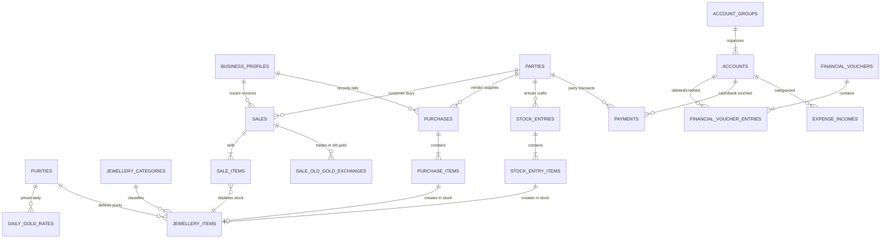

# 💎 Gold Jewellery ERP & Accounting System — Architecture & Domain Guide

> **Project:** BHARAT API (`bharat_api`) • **Domain:** Gold Jewellery Wholesale & Retail ERP  
> **Framework:** Laravel 12.x • **Database:** MySQL 8.x+ / 9.x  
> **Architecture:** RESTful Micro-Services • Double-Entry Accounting • GST Ready (Composite/Unregistered Compatible)

---

## 1. Executive Summary & Purpose

The **Gold Jewellery ERP & Accounting API** is engineered specifically for gold jewellery retail and wholesale establishments. It bridges the gap between precision physical inventory tracking (milligram-level gold weighing, purities, hallmarking) and statutory financial accounting (cash book, income, expenditure, double-entry general ledger, and Indian GST compliance).

### Core Real-World Objectives Handled:
1. **Precision Inventory**: Milligram (`0.001g`) weight accounting, Karat purities (24K, 22K, 18K, 14K), fine gold conversion, and BIS 6-digit Hallmark Unique Identification (HUID).
2. **Purchase Workflow**: Wholesale vendor procurement and customer old gold buyback.
3. **Sale Workflow**: Retail and B2B sales with live metal rates, making charges, stone charges, BIS hallmark charges, and old gold exchange credit.
4. **Production Inward (No Production Tracking Overhead)**: Seamless stock additions from internal workshops/artisans without the complexity of managing melting, alloys, and work-in-progress stages.
5. **Real-Time Cash & Bank Balance**: Daily cash-in-hand register, multiple bank accounts, UPI, and card receipts.
6. **Operating Income & Expenditure**: Instant logging of shop rent, electricity, salaries, tea/refreshments, and karigar wages.
7. **GST Reporting & Non-GST Adaptability**: Dynamic tax calculation (3% GST on gold jewellery: 1.5% CGST + 1.5% SGST or 3% IGST). Gracefully accommodates shops that **do not have a GST account** or operate under the Composition scheme.

---

## 2. System Entity Relationship & Architecture Flow

---

## 3. Gold Jewellery Formulas & Business Math

In jewellery retail, pricing is calculated dynamically based on weight, metal rates, making charges, and stones.

### 3.1 Weight Formulas (3 Decimal Precision — Milligrams)

$$\text{Net Gold Weight (g)} = \text{Gross Weight (g)} - \text{Stone/Bead Weight (g)}$$

$$\text{Fine Gold Weight (g)} = \text{Net Gold Weight (g)} \times \left( \frac{\text{Purity \%}}{100} \right)$$

* **24 Karat (999)**: $99.90\%$ pure gold
* **22 Karat (916 Hallmark)**: $91.67\%$ pure gold
* **18 Karat (750 Hallmark)**: $75.00\%$ pure gold
* **14 Karat (585 Hallmark)**: $58.50\%$ pure gold

### 3.2 Sales Price Construction Formula

$$\text{Gold Amount} = \text{Net Gold Weight (g)} \times \text{Today's Gold Rate per Gram}$$

$$\text{Making Charges} = \begin{cases} 
\text{Net Weight} \times \text{Rate/Gram} & \text{if Per Gram} \\
\text{Gold Amount} \times \left(\frac{\text{Rate \%}}{100}\right) & \text{if Percentage} \\
\text{Fixed Lump Sum} & \text{if Fixed} 
\end{cases}$$

$$\text{Taxable Value} = \text{Gold Amount} + \text{Making Charges} + \text{Stone Value} + \text{Hallmarking Fee} - \text{Discount}$$

$$\text{Total Invoice Amount} = \text{Taxable Value} + \text{Total GST (if applicable)} - \text{Old Gold Exchange Value}$$

---

## 4. The 5 Core Operating Workflows

### Workflow A: Gold Jewellery Purchase (Vendor Inward)
1. Wholesale supplier delivers gold ornaments with invoice.
2. The shop logs a `purchases` record with `purchase_items`.
3. For each physical ornament, a unique `tag_code` (e.g. `TAG-2026-0001`) is generated in `jewellery_items` with status `in_stock`.
4. Input Tax Credit (ITC) is logged if the shop is GST registered.
5. In the general ledger:
   * **Debit**: Stock in Hand / Purchases Account
   * **Debit**: CGST/SGST Input Tax Credit (if GST registered)
   * **Credit**: Vendor Account (Sundry Creditor) or Cash/Bank Account (if paid immediately).

---

### Workflow B: Inward from Production (Workshop / Artisan Inward)
> *"some time they will add jewellery in stock from production, you don't have to keep track of production."*

1. Finished ornaments arrive from in-house artisan/karigar.
2. The manager creates a `stock_entries` record with `entry_type = 'production_inward'`.
3. Each item is specified with its gross weight, stone weight, purity, and estimated valuation.
4. Each entry item immediately creates a new record in `jewellery_items` with `source_type = 'production'` and status `in_stock`.
5. No complex BOM (Bill of Materials), scrap loss, or melting stage tracking is forced on the user.

---

### Workflow C: Gold Jewellery Sale (Retail & B2B)
1. Customer selects ornaments (e.g. Necklace `TAG-2026-0001` + Ring `TAG-2026-0002`).
2. Current gold rate is fetched from `daily_gold_rates` for the respective karat.
3. Making charges, stone charges, and hallmarking charges are calculated.
4. **Old Gold Trade-In (Optional)**: If the customer brings old gold, it is weighed, purity-tested, valued, and recorded in `sale_old_gold_exchanges`. Its value is credited against the invoice total.
5. **GST Decision Rule**:
   * If shop is **GST Registered** (`is_gst_registered = true`):
     * Same State $\rightarrow$ **1.5% CGST + 1.5% SGST** (Total 3.0%)
     * Different State $\rightarrow$ **3.0% IGST**
   * If shop is **Non-GST / Unregistered** (`is_gst_registered = false`):
     * Tax rate is $0.00\%$, invoice generated as **Bill of Supply** or **Cash Memo**.
6. Sold items in `jewellery_items` are updated to status `sold` with `sold_date`.
7. Customer pays via Cash, UPI, Card, or Bank Transfer (logged in `payments`).
8. Ledger entries update Cash/Bank, Sales Income, Tax Payable, and Customer Balance.

---

### Workflow D: Daily Cash Register & Operating Income/Expenditure
1. **Cash in Hand**:
   * Opening Cash Balance + Cash Sales Receipts + Customer Debt Recoveries.
   * Less: Cash Purchases - Cash Expenses - Cash Deposited to Bank.
   * Real-time cash balance is continuously reflected in the `Cash in Hand` account.
2. **Day-to-Day Expenses**:
   * Manager logs an expense via `expense_incomes` (e.g. ₹5,000 for electricity bill paid from Cash Counter).
   * Cash account is credited, Electricity Expense account is debited immediately.
3. **Contra Entries**:
   * Cash transferred from shop counter to bank account is recorded as `contra` voucher, instantly keeping both physical cash drawer and bank statements reconciled.

---

### Workflow E: GST Compliance & GSTR Reporting
For GST-registered businesses, reports can be extracted directly from indexed fields:

| GST Report Section | Source Table & Filter | Description |
| :--- | :--- | :--- |
| **GSTR-1 Table 4 (B2B Sales)** | `sales` where `customer_gstin IS NOT NULL` | Invoices to registered businesses with invoice number, date, taxable value, and tax breakdown. |
| **GSTR-1 Table 5 (B2C Large)** | `sales` where `customer_gstin IS NULL AND tax_type = 'inter_state' AND grand_total > 250000` | Inter-state retail invoices exceeding ₹2.5 Lakhs. |
| **GSTR-1 Table 7 (B2C Small)** | `sales` where `customer_gstin IS NULL` (remaining) | Intra-state retail sales and small inter-state retail sales grouped by state rate. |
| **GSTR-1 Table 12 (HSN Summary)** | `sale_items` grouped by `hsn_code` | Total quantity (grams), total value, taxable value, CGST, SGST, IGST under HSN 7113. |
| **GSTR-3B Table 3.1 (Outward Tax Liability)** | `sales` sum of `taxable_amount`, `cgst_amount`, `sgst_amount`, `igst_amount` | Total output tax liability to pay the government. |
| **GSTR-3B Table 4 (Eligible ITC)** | `purchases` + `expense_incomes` (where `is_gst_claimed = true`) | Input Tax Credit on vendor purchases and business expenses. |

> **Non-GST Entities**: When `is_gst_registered` is `false`, GST report generation flags the organization as exempt/unregistered, preventing erroneous tax returns and allowing standard P&L/Balance Sheet generation.

---

## 5. Complete Database Schema Blueprint (13 Migrations)

| Step | Migration File | Tables Created | Core Responsibility |
| :---: | :--- | :--- | :--- |
| 1 | `...000001_create_business_profiles_table.php` | `business_profiles` | Shop details, GST registration status, PAN, BIS hallmark license, default numbering prefixes. |
| 2 | `...000002_create_jewellery_categories_table.php` | `jewellery_categories` | Ring, Necklace, Bangle, Coin, Bar; default HSN 7113 / 7108. |
| 3 | `...000003_create_purities_table.php` | `purities` | 24K (999), 22K (916), 18K (750), 14K (585) with purity percentages. |
| 4 | `...000004_create_daily_gold_rates_table.php` | `daily_gold_rates` | Daily selling rate and buyback rate per gram for each purity. |
| 5 | `...000005_create_parties_table.php` | `parties` | Customers, Vendors, and Artisans with GSTIN, PAN, state code, and credit balance. |
| 6 | `...000006_create_jewellery_items_table.php` | `jewellery_items` | Individual inventory tags: barcode, gross weight, stone weight, net weight, fine weight, HUID, status. |
| 7 | `...000007_create_stock_entries_table.php` | `stock_entries`, `stock_entry_items` | Stock inward from in-house production / artisan arrival without manufacturing pipeline tracking. |
| 8 | `...000008_create_purchases_table.php` | `purchases`, `purchase_items` | Vendor jewellery purchases and raw gold buyback with weights, rate, and ITC tracking. |
| 9 | `...000009_create_sales_table.php` | `sales`, `sale_items`, `sale_old_gold_exchanges` | Sales invoices with making charges, stones, hallmarking, old gold exchange deduction, and GST. |
| 10 | `...000010_create_account_groups_and_accounts_table.php` | `account_groups`, `accounts` | Chart of accounts: Cash in Hand, Bank Accounts, Sales, Purchases, Rent, Electricity, Tax accounts. |
| 11 | `...000011_create_financial_vouchers_table.php` | `financial_vouchers`, `financial_voucher_entries` | Double-entry general ledger journal with debits and credits for full accounting integrity. |
| 12 | `...000012_create_payments_table.php` | `payments` | Cash/Bank book: logs receipts and payments with modes (Cash, UPI, Bank Transfer, Card, Cheque). |
| 13 | `...000013_create_expense_incomes_table.php` | `expense_incomes` | Fast shop operating income & expenditure logging with instant cash/bank account balance updates. |
| 14 | `...000014_create_sales_and_purchase_returns_table.php` | `sales_returns`, `sales_return_items`, `purchase_returns`, `purchase_return_items` | Credit Notes (GSTR-1 Table 9B) and Debit Notes for customer returns/exchanges and vendor purchase returns with stock restock/scrap actions. |
